#  zstack

[中文](README.md) | English

An opinionated, battle-tested **AI Agent engineering & governance skill stack** refined across daily multi-client workflows (Claude Code, Codex, Cursor, pi): align on **What** before **How**, run multi-vendor blind **Arenas** on high-cost design choices, verify with tight runtime loops, and continuously prune prompt and skill debt.

---

## Why `zstack` Exists

Running coding agents across real repositories every day exposes four recurring failure modes that single-shot prompt tricks don't solve:

1. **Misaligned Sprints vs. Approval Fatigue**
   The most expensive agent failure isn't a syntax error—it's sprinting 1,000 lines down a wrong assumption. Conversely, telling the agent "always ask me first" turns you into a rubber-stamping bottleneck.
   - **The Fix**: [`grill`](skills/grill/SKILL.md) interviews you three frontier questions a round on **Whats** (observable outcome, proof, constraints, limits) while dispatching fresh-context subagents to look up codebase facts on its own. [`owner-mode`](skills/owner-mode/SKILL.md) draws a crisp boundary around the **Owner's Domain** (taste, model choice, security, external side effects, irreversible deletions): reversible engineering steps run to completion uninterrupted; boundary decisions are batched into one structured prompt.

2. **Costly Architectural Shapes & Single-Model Echo Chambers**
   Picking the wrong module boundary or state ownership costs days to unwind, and asking the same model that wrote a design to critique it usually yields polite agreement.
   - **The Fix**: [`arena`](skills/arena/SKILL.md) (adapted from `pstack`) pits multiple frontier model families against the same brief to produce **throwaway design sketches** (call sites, types, signatures, tradeoffs—no implementation), scores them blind with a cross-vendor read-only reviewer, picks one maintainable base, and grafts the best ideas from runners-up into a single coherent mental model.

3. **Guess-Driven Debugging, Cross-Shell Traps & Weakened Assertions**
   Hypothesizing before building a deterministic red signal wastes hours, and mixing Git Bash with PowerShell 7 on Windows silently corrupts encodings, line endings, and POSIX-looking flags.
   - **The Fix**: [`diagnosing-bugs`](skills/diagnosing-bugs/SKILL.md) gates hypothesis testing behind a fast, deterministic red-capable loop and minimal repro; [`windows-shell`](skills/windows-shell/SKILL.md) pairs `doctor.ps1` with five iron rules for dual-shell execution; [`templates/REVIEW.md`](templates/REVIEW.md) standardizes fresh-context cross-vendor code review across Correctness, Security/Data, and Goal Alignment.

4. **Prompt & Skill Sediment Over Time**
   Adding a rule to `AGENTS.md` after every hiccup bloats always-loaded context until critical guardrails get drowned out and overlapping skills steal each other's triggers.
   - **The Fix**: [`writing-for-agents`](skills/writing-for-agents/SKILL.md) and [`universal-model-prompting`](skills/universal-model-prompting/SKILL.md) keep always-loaded instructions down to thin `Do X -> Read Y` pointers while separating portable contracts from vendor-specific knobs. [`retro`](skills/retro/SKILL.md) turns real session friction into immediate two-way-door fixes or shared cross-agent memories, and [`skill-pruning`](skills/skill-pruning/SKILL.md) audits 45-day session usage evidence to enforce `<= 500B` description budgets.

---

## Workflow Overview & Skill Reference

```mermaid
flowchart LR
    subgraph S1["1. Align & Design"]
        G["grill<br/>3-Q Frontier Design Tree"]
        A["arena<br/>Multi-Vendor Design Arena"]
        O["owner-mode<br/>Autonomy & Pareto Tradeoffs"]
    end

    subgraph S2["2. Execute, Debug & Review"]
        K["karpathy-guidelines<br/>Explicit Assumptions · Surgical Edits"]
        D["diagnosing-bugs<br/>Tight Red-Capable Loop"]
        W["windows-shell<br/>bash / pwsh 7 Guardrails"]
        UPR["upstream-pr<br/>OSS PR Pre-Flight & Review Loop"]
        R["REVIEW.md<br/>3-Pass Cross-Vendor Review"]
    end

    subgraph S3["3. Prompt, Explain & Diagram"]
        WA["writing-for-agents<br/>Thin Pointers & Disclosure"]
        UP["universal-model-prompting<br/>Portable Core + Adapter Layer"]
        AD["architecture-diagram<br/>Hand-Placed Inline SVG Sheets"]
        WW["wait-what<br/>Jargon-Free Plain Translation"]
    end

    subgraph S4["4. Retro, Memory & Prune"]
        MR["memory-routing<br/>SSOT -> Distilled -> Transcripts"]
        RE["retro<br/>9-Class Triage & Shared Memory"]
        SP["skill-pruning<br/>45-Day Evidence & Budget Audit"]
    end

    S1 --> S2 --> S4
    S3 -. Cross-cutting .-> S2
    S4 -. Distilled pointers & lessons .-> S1
```



### Included Skills (14)

| Phase | Skill | When It Fires / Example Trigger | What It Does |
| --- | --- | --- | --- |
| **Align & Design** | [`grill`](skills/grill/SKILL.md) | `grill me`, `拷问我`, pre-implementation alignment | Walks the design tree 3 frontier questions a round on Whats, dispatches fresh subagents for facts, closes with Goal + How sketch |
| **Align & Design** | [`arena`](skills/arena/SKILL.md) | `arena`, `design it twice`, `上擂台` | Parallel multi-vendor design sketches -> blind rubric review -> base selection + surgical grafting (stops at design) |
| **Align & Design** | [`owner-mode`](skills/owner-mode/SKILL.md) | Before asking, deleting, abstracting, or building vs. reusing | Defines Owner's Domain, Structural Fix vs. Periodic Sweep, and 9 engineering tradeoff heuristics |
| **Execute & Debug** | [`karpathy-guidelines`](skills/karpathy-guidelines/SKILL.md) | Non-trivial coding, refactoring, architecture | Surface assumptions, simplicity first, surgical diffs, verifiable completion criteria |
| **Execute & Debug** | [`diagnosing-bugs`](skills/diagnosing-bugs/SKILL.md) | `diagnose`, `debug this`, flaky/slow/broken runs | 6-phase gated loop: tight red-capable signal -> minimal repro -> falsifiable hypotheses -> tagged probes -> frozen red-green test |
| **Execute & Debug** | [`windows-shell`](skills/windows-shell/SKILL.md) | Running shell commands or scripts on Windows | Ships `scripts/doctor.ps1`; detects real host shell (`bash` vs `pwsh 7`), prevents ACP 936/UTF-8 garbling, CRLF diffs, and MSYS path mangling |
| **Execute & Debug** | [`upstream-pr`](skills/upstream-pr/SKILL.md) | Opening OSS PRs, addressing maintainer reviews, conflicts | 7-point maintainer pre-flight, incremental review commits, human-tone PR replies without AI slop, and false-conflict checks |
| **Author & Visuals** | [`writing-for-agents`](skills/writing-for-agents/SKILL.md) | Writing/editing `SKILL.md`, `AGENTS.md`, rules | Context pointers, context vs. cognitive load, progressive disclosure, completion demand, leading words |
| **Author & Visuals** | [`universal-model-prompting`](skills/universal-model-prompting/SKILL.md) | Designing/auditing system prompts or migrating models | Splits prompts into an outcome-first portable contract + verified provider capability adapter + side-by-side eval matrix |
| **Author & Visuals** | [`architecture-diagram`](skills/architecture-diagram/SKILL.md) | System overview, data-flow, or deployment diagrams | Ships `svgkit.py` + headless `render_check.js`: hand-placed inline SVG drafting sheets with dark/light tokens, flow filters, and privacy redaction scan |
| **Author & Visuals** | [`wait-what`](skills/wait-what/SKILL.md) | `wait what`, `说人话`, cryptic agent reports | Translates dense agent messages into `1-sentence impact + required action + glossary terms` without inventing facts |
| **Retro & Govern** | [`memory-routing`](skills/memory-routing/SKILL.md) | Searching past context, prior bugs, or session handoff | Strict 3-tier lookup: Repo SSOT (0 latency) -> Distilled cross-project memory (e.g. OpenViking) -> Raw transcripts (e.g. `deja`) |
| **Retro & Govern** | [`retro`](skills/retro/SKILL.md) | `/retro`, post-session reflection | Anchors friction to exact session timestamps across 9 classes; executes reversible two-way doors immediately, logs one-way doors, verifies memory recall |
| **Retro & Govern** | [`skill-pruning`](skills/skill-pruning/SKILL.md) | Periodic skill-library audit & deduplication | Ships 0-token `scripts/skill_evidence.py`: measures 45-day session hits, flags `>500B` descriptions & `>500`-line bodies, retires duplicate triggers |

> **Language Note**: Several skills in `zstack` (`arena`, `owner-mode`, `windows-shell`, `upstream-pr`, `universal-model-prompting`, `architecture-diagram`, `wait-what`, `retro`, `skill-pruning`) are authored primarily in Simplified Chinese with bilingual English/Chinese trigger keywords, while `grill`, `memory-routing`, `writing-for-agents`, `diagnosing-bugs`, and `karpathy-guidelines` are in English. Frontier models follow both seamlessly regardless of your chat language.

### Companion Templates (`templates/`)

- [`templates/AGENTS.core.md`](templates/AGENTS.core.md): A compact (~3.5 KB) global core instruction block for `~/.claude/CLAUDE.md`, `~/.codex/AGENTS.md`, `~/.pi/agent/AGENTS.md`, or repo-root `AGENTS.md`.
- [`templates/REVIEW.md`](templates/REVIEW.md): Three-pass independent review rubric (Correctness, Security & Data, Alignment) with P0/P1/P2 severity gates.

---

## Installation (30-Second Setup)

Pick **one** installation method per agent harness so skills are not registered twice.

### Option 1: `skills.sh` CLI (Cursor, pi, Windsurf, OpenCode, Amp, etc.)

```bash
npx skills@latest add incredible404-rgb/zstack
# Or target a specific agent harness:
npx skills@latest add incredible404-rgb/zstack -a pi
```

### Option 2: Claude Code Plugin Marketplace

```bash
/plugin marketplace add incredible404-rgb/zstack
/plugin install zstack@incredible404-rgb
```

### Option 3: Codex Plugin Marketplace

```bash
codex plugin marketplace add incredible404-rgb/zstack
codex plugin add zstack@incredible404-rgb
```

### Option 4: Gemini CLI

```bash
gemini skills install https://github.com/incredible404-rgb/zstack.git --path skills
```

### Option 5: Clone & Copy/Symlink to `~/.agents/skills` (Best for Hacking & Customizing)

```bash
git clone https://github.com/incredible404-rgb/zstack.git ~/zstack
mkdir -p ~/.agents/skills
cp -r ~/zstack/skills/* ~/.agents/skills/
```

---

## Advanced Architecture: Two-Tier Weekly Review & Outer Review

Installing good skills solves day-one ergonomics; keeping an agent environment sharp over months requires a **subtraction loop**. Alongside `zstack`, my local setup runs two lightweight governance patterns that you can adapt to your own stack:

### 1. Project × Global Two-Tier Weekly Review

- **Zero-Token Verbatim Harvesting**: A local script scans session JSONLs across all active harnesses, strips injected system blocks and tool outputs, and extracts only **verbatim human prompts**, routing them into *Project-level* vs. *Global-level* buckets alongside deterministic lint clues (dead paths, drift, instruction byte budgets).
- **Strict Territorial Isolation + Upward/Downward Exchange**:
  - The *Project Review* only mutates the project repository and logs generalizable lessons under an *Upward to Global* section.
  - The *Global Review* only mutates shared global instructions/skills and logs project-specific rollouts under *Downward to Projects*. Neither tier edits the other's files.
- **Bounded Autonomy + Cross-Vendor Gate**: Mechanical fixes (broken pointers, credential redaction, stale lines) execute autonomously and pass a cross-vendor `reviewer` gate before commit; changes affecting taste, permissions, or rule semantics become checkboxes in `proposals.md` awaiting human sign-off. Quiet weeks send zero notifications.

### 2. Outer Review (Stepping Outside the Ruler)

Weekly reviews optimize *within* your current `GOALS.md`, which means they never question whether the ruler itself has gone stale after a frontier model upgrade. **Outer Review** is a strictly manual, on-demand reset:

1. **Isolated Blind Rewrite**: In a sandboxed run with **zero access to current rules or `GOALS.md`**, a model receives only historical verbatim user corrections + current official vendor prompting guides, drafting a clean-slate core instruction file free of legacy anchoring.
2. **Cross-Vendor Blind Comparison**: A different model family compares the *current rules* against the *blind draft*, surfacing legacy crutches that new models no longer need, recurring blind spots, and historical decisions that must be preserved (verified via `git log`).
3. **Max 5 Intent Decisions + Canary Rollout**: Diffs are grouped into **at most 5 high-level decisions** (with verbatim evidence and rollback commands) to prevent approval fatigue. Approved changes ship to 1–2 primary clients as a **Canary** for one week and graduate to all clients only if the next weekly review observes zero recurrence.

---

## Companion Projects & Attribution

### Companion Open-Source Projects

- [**PiDeck**](https://github.com/incredible404-rgb/PiDeck): Multi-project desktop workspace for managing local AI coding agent sessions, Git worktrees, terminals, and plugins.
- [**colab-gpu-llm-service**](https://github.com/incredible404-rgb/colab-gpu-llm-service) & [**Colab-yoga**](https://github.com/incredible404-rgb/Colab-yoga): Headless 96GB Colab GPU GGUF LLM serving over Tailscale with a native Windows system-tray controller.

### Attribution

Released under the **MIT License**. `zstack` builds on and bundles foundational work from open-source pioneers—full file-level lineage and copyright notices live in [`NOTICE`](NOTICE):

- [**`mattpocock/skills`**](https://github.com/mattpocock/skills) by Matt Pocock (MIT) — inspired `grill`, `retro`, and `wait-what`; bundled `writing-for-agents` and `diagnosing-bugs`.
- [**`cursor/plugins/pstack`**](https://github.com/cursor/plugins/tree/main/pstack) by Lauren Tan / `poteto` (MIT) — inspired `arena`.
- [**`multica-ai/andrej-karpathy-skills`**](https://github.com/multica-ai/andrej-karpathy-skills) (MIT) — bundled `karpathy-guidelines`.

---

## Maintainer Updates & Validation

`zstack` is updated manually after major local workflow iterations rather than via noisy automated commits.

```bash
# Validate all SKILL.md frontmatters, <=500B description budgets, <=500-line limits, and plugin manifests
python scripts/sync_local.py --validate

# Compare repository skills against local ~/.agents/skills
python scripts/sync_local.py
```
