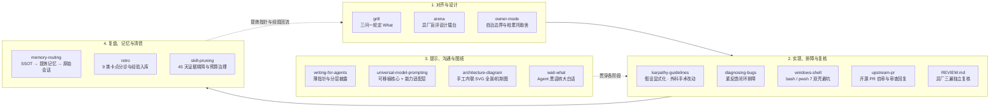

#  zstack

中文 | [English](README.en.md)

一套在多客户端（Claude Code、Codex、Cursor、pi 等）日常高频迭代中打磨出来的**个人 AI Agent 工程与治理技能栈**：先对齐 What 再动手，高代价设计上异厂盲评擂台，用紧反馈闭环修代码，再靠会话复盘与证据驱动清扫让指令和技能越用越薄。

---

## 为什么整理这套技能？

把开源社区的单点技巧放进每天真实跑多客户端、多模型的重度工程环境里，最容易撞上四类失控：

1. **需求没对齐就猛写，或者每步都停下来请示废话**
   Agent 最昂贵的错误不是语法报错，而是沿着错误假设狂奔一千行；反过来，处处写"先问我"又会把人拖成审批机器。
   - **解法**：[`grill`](skills/grill/SKILL.md) 以三问一轮的设计树追问 **What**（结果、可观察验收证据、边界、上限），把能自己查证的事实派给全新上下文子代理去跑；[`owner-mode`](skills/owner-mode/SKILL.md) 划清「本人的域」（品味、模型、安全、对外动作、不可逆删除），域外可逆步骤直接做到底，触及边界一次问清。

2. **关键架构选错形状，同一家模型自己审自己**
   新模块、状态归属或接口契约一旦选错形状，返工极贵；让写出方案的同一模型做自我批评，往往只是换个语气顺着原思路圆场。
   - **解法**：[`arena`](skills/arena/SKILL.md)（吸收改写自 `pstack`）对高返工代价的设计开**异厂盲评擂台**——不同厂商模型并行独立出草图（只写调用点、签名、数据结构与取舍，不写成品实现），由另一厂商模型按隐藏评分表盲评推荐底版，再把落选稿的闪光点手工嫁接进底版，保持单一心智模型。

3. **靠猜修 Bug、跨壳命令反复翻车、改宽断言凑绿灯**
   没有能稳定泛红的复现闭环就去读代码猜原因，十有八九修偏；在 Windows 上混用 Git Bash 与 PowerShell 7，还会被编码、CRLF 和路径改写反复绊倒。
   - **解法**：[`diagnosing-bugs`](skills/diagnosing-bugs/SKILL.md) 强制先建秒级、确定性、能泛红的反馈闭环并最小化复现；[`windows-shell`](skills/windows-shell/SKILL.md) 配套 `doctor.ps1` 先认清宿主壳与代码页，用五条铁律封死跨壳转义和换行污染；收尾对照 [`templates/REVIEW.md`](templates/REVIEW.md) 派异厂模型做正确性 / 安全与数据 / 目标对齐三遍复核。

4. **用得越久，`AGENTS.md` 与技能目录越肿、越容易互相抢词**
   每次踩坑都往常驻提示词里塞一段话，三个月后上下文全被过时补丁占满，真正关键的边界反而被稀释。
   - **解法**：按 [`writing-for-agents`](skills/writing-for-agents/SKILL.md) 与 [`universal-model-prompting`](skills/universal-model-prompting/SKILL.md) 把常驻层压成一行「做 X 读 Y」指针，可移植任务合同与供应商能力适配层彻底分离；会话卡壳后跑 [`retro`](skills/retro/SKILL.md) 锚定具体时刻做单/双向门分诊（双向门当场修好验绿，经验沉淀进共享记忆）；定期跑 [`skill-pruning`](skills/skill-pruning/SKILL.md) 采集近 45 天真实读取证据，守住 `<= 500B` 简介预算并清退僵尸技能。

---

## 工作流全景与技能速查



### 14 个收录技能一览

| 阶段 | 技能 | 触发时机 / 口令示例 | 核心作用 |
| --- | --- | --- | --- |
| **对齐与设计** | [`grill`](skills/grill/SKILL.md) | 「grill me」「拷问我」「先问清楚再做」 | 每轮 3 个前沿问题追问 What、派新上下文子代理自查事实，收尾输出目标合同 + How 概要 |
| **对齐与设计** | [`arena`](skills/arena/SKILL.md) | 「arena 一下」「上擂台」「多方案对比」 | 异厂模型并行出设计草图 → 只读盲评打分选底版 → 手工嫁接落选稿长处（只到草图，不做成品） |
| **对齐与设计** | [`owner-mode`](skills/owner-mode/SKILL.md) | 判断要不要先问、删还是留、自造还是复用开源前 | 明确「本人的域」、一劳永逸（编译进脚本/钩子）vs 循环清扫（定期减法）及九组情境拉扯表 |
| **实现与排障** | [`karpathy-guidelines`](skills/karpathy-guidelines/SKILL.md) | 非琐碎编码、重构、架构改动 | 显式声明假设、最小够用实现、只动目标行的外科手术修改、定义可验证完成标准 |
| **实现与排障** | [`diagnosing-bugs`](skills/diagnosing-bugs/SKILL.md) | 「排查」「debug this」、遇到报错/跑挂/变慢 | 六阶段纪律：先搭可泛红的紧闭环 → 最小化复现 → 3–5 个可证伪假设 → 打标探针 → 先红后绿回归测试 |
| **实现与排障** | [`windows-shell`](skills/windows-shell/SKILL.md) | Windows 下跑命令、写 `.ps1`/`.sh`、遇乱码或转义坑 | 附 `scripts/doctor.ps1`；先认宿主壳（bash vs pwsh 7），解决 ACP 936/65001、CRLF、MSYS 路径改写与商店垫片挂死 |
| **实现与排障** | [`upstream-pr`](skills/upstream-pr/SKILL.md) | 向外部开源仓提 PR、改审查意见、回评论、解冲突 | 维护者视角七项自审、追加 commit 增量重审、去 AI 味工程师回复口吻、合并假冲突排查与日志卫生 |
| **提示与表达** | [`writing-for-agents`](skills/writing-for-agents/SKILL.md) | 编写或修改 `SKILL.md`、`AGENTS.md`、项目规则 | 上下文指针（Context Pointers）、双重负载权衡、信息层级与渐进式披露、引导词（Leading Words） |
| **提示与表达** | [`universal-model-prompting`](skills/universal-model-prompting/SKILL.md) | 设计/审计复杂 System Prompt、人格或跨模型迁移 | 将提示词拆成「可移植行为合同」与「供应商能力适配层」，附跨模型同题验收矩阵与人格测试套件 |
| **提示与表达** | [`architecture-diagram`](skills/architecture-diagram/SKILL.md) | 「画个架构图」「系统全景图」「数据流图」 | 附 `svgkit.py` 与无头浏览器 `render_check.js`：手工排版内联 SVG 全景图 + 机制图，支持流向筛选、亮暗主题与分享打码扫描 |
| **提示与表达** | [`wait-what`](skills/wait-what/SKILL.md) | 「说人话」「你刚才说的没看懂」「wait what」 | 把 Agent 充满内部黑话的长回复/推送浓缩为「一句话影响 + 要你做的事 + 生词对照」，并按需维护术语表 |
| **复盘与治理** | [`memory-routing`](skills/memory-routing/SKILL.md) | 查过往决定、历史报错，或跨会话交接长任务 | 严格三层检索优先级：仓库现行 SSOT（0 延迟）→ 跨项目提炼记忆（如 OpenViking）→ 原始会话记录（如 `deja`） |
| **复盘与治理** | [`retro`](skills/retro/SKILL.md) | `/retro`、「复盘一下这次会话」 | 锚定会话真实卡点时刻，对照 9 类归因与单/双向门分诊：双向门当场改完验绿提交，单向门入台账，经验写进共享记忆并实测召回 |
| **复盘与治理** | [`skill-pruning`](skills/skill-pruning/SKILL.md) | 「精简技能」「清理技能债」或定期审计 | 附 0-token `scripts/skill_evidence.py`：统计近 45 天真实读取会话数、检查 `>500B` 简介与 `>500` 行正文，收敛重复触发入口 |

### 配套底座模板（`templates/`）

技能需要一层干净的常驻薄指针配合才能发挥最大威力，本仓库在 [`templates/`](templates/) 下提供了两份可直接复用的底座：

- [`templates/AGENTS.core.md`](templates/AGENTS.core.md)：精简的全局协作纪律模板（可放入 `~/.claude/CLAUDE.md`、`~/.codex/AGENTS.md`、`~/.pi/agent/AGENTS.md` 或项目根 `AGENTS.md`），约 3.5 KB，只立硬边界与技能指针。
- [`templates/REVIEW.md`](templates/REVIEW.md)：独立复核标尺（供 `reviewer` 子代理或跨模型审查读取，统一正确性 / 安全与数据 / 对齐三遍审查与 P0/P1/P2 口径）。

---

## 安装指南（30 秒接入）

你可以按习惯任选**插件模式**或**本地文件模式**。同一个客户端只选一种方式，避免同一技能重复出现两次。

### 方式 1：通用 CLI 安装（Cursor / pi / Windsurf / OpenCode / Amp 等）

```bash
npx skills@latest add incredible404-rgb/zstack
# 或指定目标客户端：
npx skills@latest add incredible404-rgb/zstack -a pi
```

### 方式 2：Claude Code 插件市场

```bash
/plugin marketplace add incredible404-rgb/zstack
/plugin install zstack@incredible404-rgb
```

### 方式 3：Codex 插件市场

```bash
codex plugin marketplace add incredible404-rgb/zstack
codex plugin add zstack@incredible404-rgb
```

### 方式 4：Gemini CLI

```bash
gemini skills install https://github.com/incredible404-rgb/zstack.git --path skills
```

### 方式 5：克隆并软链到 `~/.agents/skills`（最适合自己魔改与多端共享）

许多客户端（Codex、pi 等）及本地技能分发网关原生读取 `~/.agents/skills`。克隆后按需软链或复制，想改哪条直接改本地文件：

```bash
git clone https://github.com/incredible404-rgb/zstack.git ~/zstack
mkdir -p ~/.agents/skills
cp -r ~/zstack/skills/* ~/.agents/skills/
```

---

## 进阶：如何让这套体系长期自演进而不腐化？

如果你也在同时使用多个 AI 编码客户端，光装一批技能还不够——日常对话里不断冒出的新偏好、顺手打的补丁和模型换代，会让规则库在几个月内重新膨胀。我在本地配合 `zstack` 跑着两层低打扰的治理闭环，核心思路分享如下，你可以很容易在自己的环境里复刻：

### 1. 项目层 × 通用层「双层周审」（Two-Tier Weekly Review）

- **0 Token 采集本人原话**：每周用轻量脚本只读扫描各客户端本地会话 JSONL，剥掉系统注入、子代理回报与工具输出，只提取**本人亲手输入的原话**，按工作目录与关键词自动分流到「项目层」或「全局通用层」，并做漂移、失效路径与指令字节预算检查（如全局指令硬上限 `7,777` 字节）。
- **地盘隔离与上下渗透**：
  - **项目周审**只改项目仓库内的文档、测试与脚本；发现普适经验时写进记录的「上浮给通用层」一节。
  - **通用周审**只改多客户端共用的全局薄指针与共享技能；涉及具体项目的推广写进「下沉给项目」一节。两层互不越界改文件。
- **有限自治 + 异厂复核门禁**：失效路径清理、记忆凭据打码、过期行修剪等**双向门**由周审自动完成并过一次异厂 `reviewer` 门禁后提交；涉及个人品味、权限边界或规则含义变化的**单向门**只写入 `proposals.md` 待批列表，人在空余时勾 `[x]` 才会在下周落地。平静周全程不发通知。

### 2. 跳出既有标尺的「外层重审」（Outer Review）

日常周审只会沿着既有目标（GOALS）清债，永远不会质疑这把尺子本身是否已经过时（例如主力模型换代后，以前防旧模型犯傻的拐杖规则今天反而束缚了新模型）。为此专门保留一个**只由人工手动触发、绝不定时跑**的「外层重审」机制：

1. **隔离盲写（Blind Rewrite）**：在完全隔离的沙箱会话里，**不给模型看现行规则与 GOALS**，只喂给它「过去一段时间本人的真实纠正原话 + 各厂商最新官方模型指南」，让它从零起草一份全局规则。这样能彻底斩断对旧条文的路径依赖。
2. **异厂盲评对比（Cross-Vendor Diff）**：换另一家厂商的强推理模型，只读对比「现行规则」与「盲写稿」（此时不喂碎原话防干扰），找出现行规则里可以砍掉的旧拐杖、漏掉的高频摩擦，以及盲写稿误删的历史定案（自动回查 `git log` 核实）。
3. **每次最多 5 个意图决定 + 金丝雀放量（Canary Rollout）**：所有改动按意图打包成**最多 5 个决定**（带原话证据与回退命令）交本人拍板，拒绝逐行审批疲劳。获批改动先渲染进 1–2 个主力交互客户端试跑一周（Canary），下一次周审核对同类纠正零复发后，再全量同步到所有客户端。

---

## 周边配套生态与致谢

### 配套开源项目

- [**PiDeck**](https://github.com/incredible404-rgb/PiDeck)：多项目 AI Agent 桌面工作台，统一管理本地会话、Git 工作树、终端与模型插件。
- [**colab-gpu-llm-service**](https://github.com/incredible404-rgb/colab-gpu-llm-service) & [**Colab-yoga**](https://github.com/incredible404-rgb/Colab-yoga)：在 Colab 96GB GPU 上无头部署百 GB 级 GGUF 大模型，并由 Windows 系统托盘一键唤醒、保活与自动关停。

### 代码来源与致谢（Attribution）

本仓库站在多个优秀开源项目的肩膀上构建，采用 **MIT License** 开源，完整文件级来源与协议说明见 [`NOTICE`](NOTICE)：

- [**`mattpocock/skills`**](https://github.com/mattpocock/skills)（Matt Pocock，MIT）：启发了 `grill`、`retro`、`wait-what` 的核心交互范式，并捆绑收录了 `writing-for-agents` 与 `diagnosing-bugs` 底座技能（补充中文触发边界）。
- [**`cursor/plugins/pstack`**](https://github.com/cursor/plugins/tree/main/pstack)（Lauren Tan / `poteto`，MIT）：启发了 `arena` 的异厂候选盲评与底版嫁接工作流。
- [**`multica-ai/andrej-karpathy-skills`**](https://github.com/multica-ai/andrej-karpathy-skills)（MIT）：整理自 Andrej Karpathy 关于 LLM 编码习惯的总结，捆绑为 `karpathy-guidelines`。

---

## 更新与本地维护说明

本仓库采用**大迭代不定期手动整理推送**策略（不做高频自动同步，确保每次推上来的版本都经过日常真实工程检验与脱敏预检）。

维护者自检与本地差异比对命令：

```bash
# 校验全部技能的 YAML frontmatter、<=500B 简介预算、<=500 行正文上限与插件清单一致性
python scripts/sync_local.py --validate

# 对比本机 ~/.agents/skills 与仓库脱敏版的改动差异
python scripts/sync_local.py
python scripts/sync_local.py --diff arena retro
```
